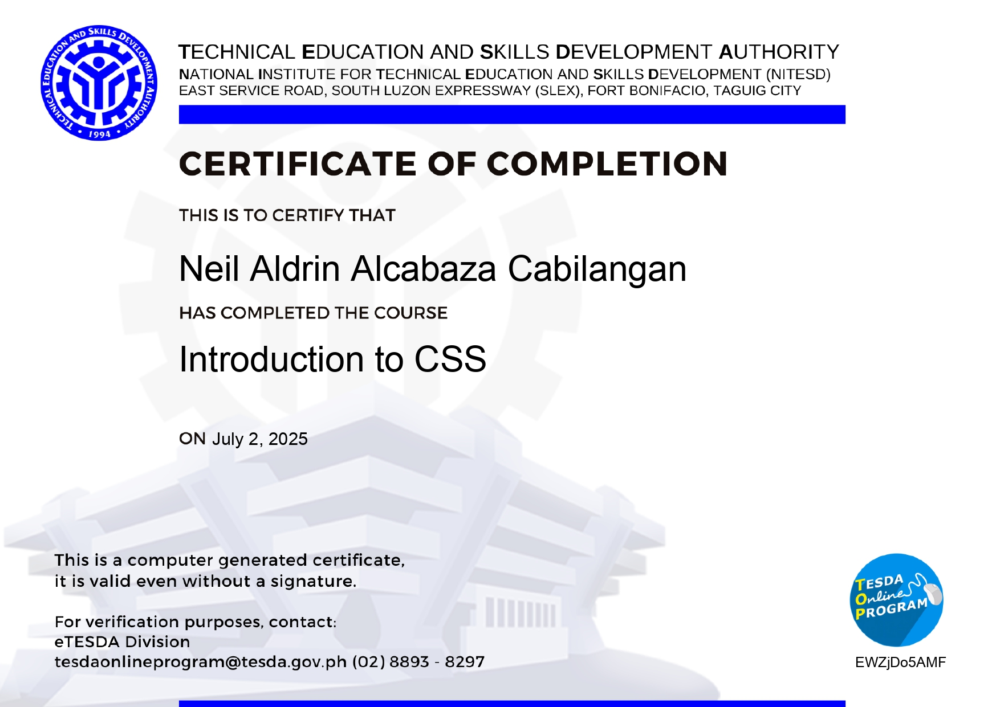
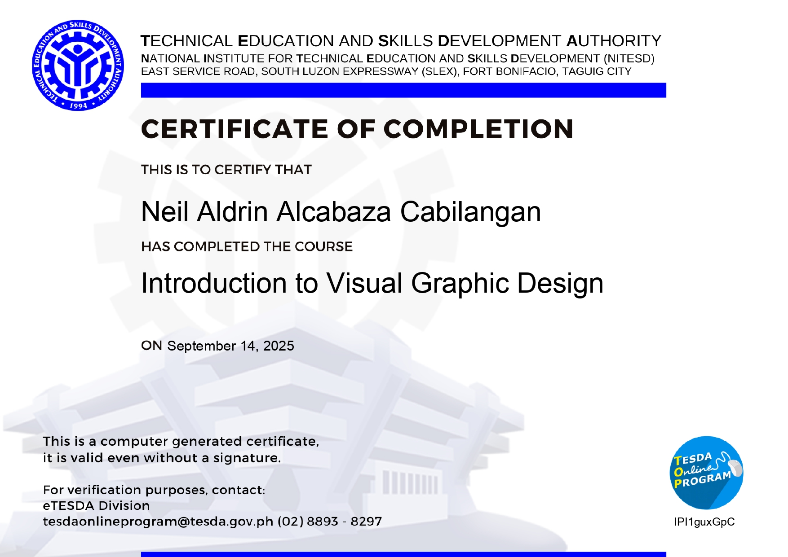
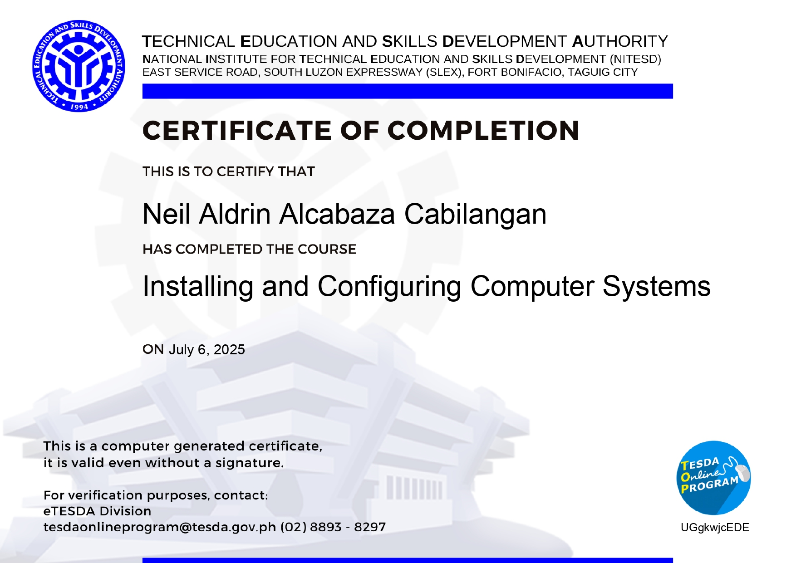
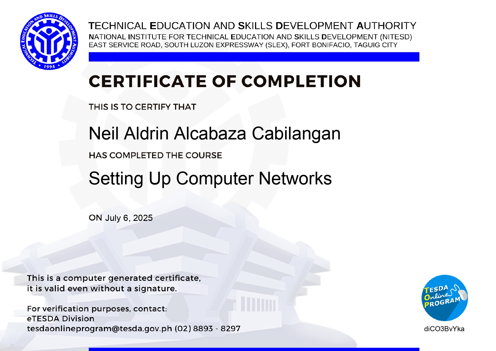
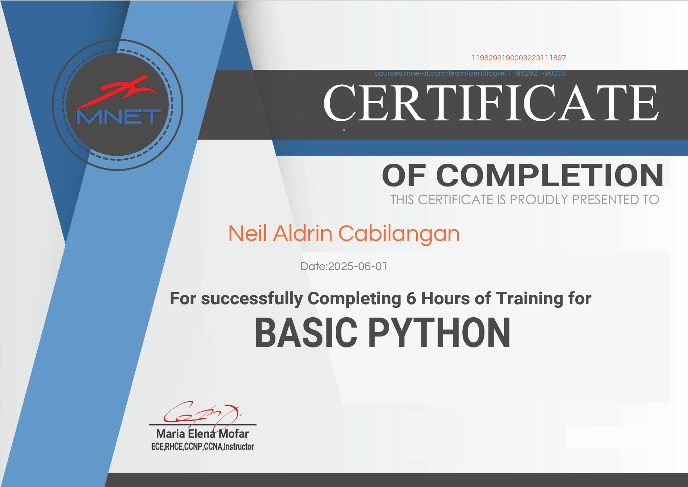
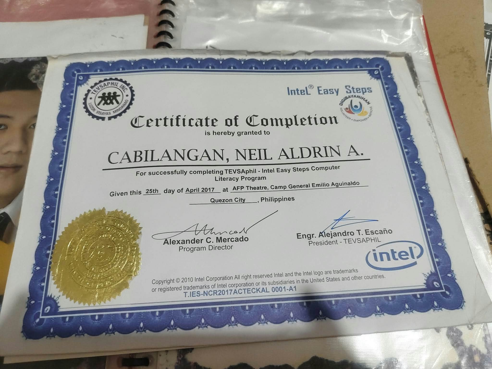
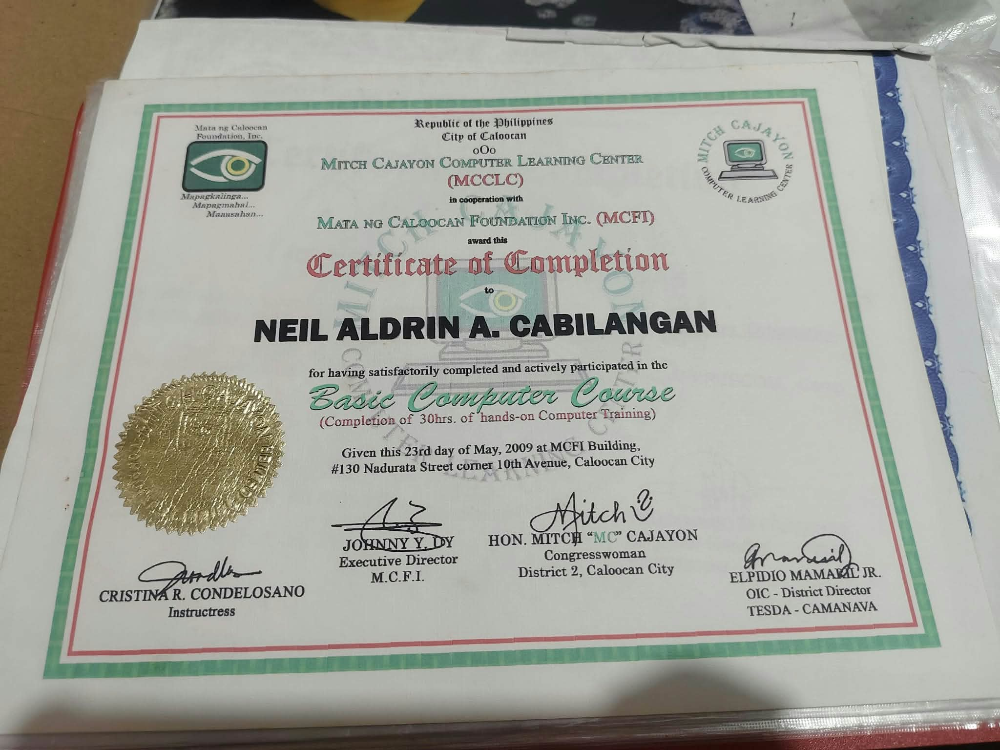
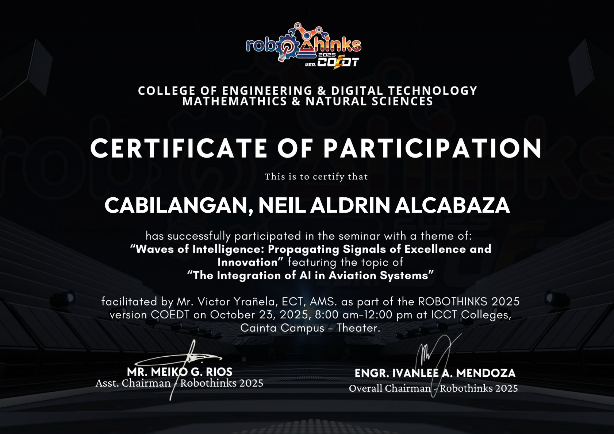
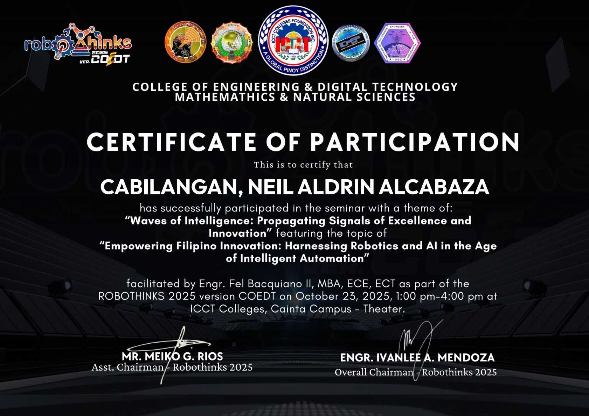

<!DOCTYPE html>
<html lang="en">

<head>
    <meta charset="UTF-8">
    <meta name="viewport" content="width=device-width, initial-scale=1.0">

    <title>NiruDesu Portfolio</title>

    <!-- CSS -->
    <link rel="stylesheet" href="style.css">

    <!-- FONT AWESOME -->
    <link rel="stylesheet"
        href="https://cdnjs.cloudflare.com/ajax/libs/font-awesome/6.7.2/css/all.min.css">

    <!-- POPPINS FONT -->
    <link href="https://fonts.googleapis.com/css2?family=Poppins:wght@400;500;600;700&display=swap"
        rel="stylesheet">
</head>

<body>

    <!-- NAVIGATION -->
    <header>
        <nav>
            <h2 class="logo">
                &lt;/&gt; NiruDesu
            </h2>

            <ul>
                <li><a href="#home">Home</a></li>
                <li><a href="#about">About</a></li>
                <li><a href="#skills">Skills</a></li>
                <li><a href="#projects">Projects</a></li>
                <li><a href="#education">Education</a></li>
                <li><a href="#achievements">Achievements</a></li>
                <li><a href="#contact">Contact</a></li>
            </ul>

            <button id="theme-toggle">☀️ Light Mode</button>
        </nav>
    </header>

    <!-- HOME SECTION -->
    <section id="home">
        

        

            

                
            

            

                <h3>WELCOME TO MY PORTFOLIO</h3>

                <h1>Hello, I'm Neil Aldrin Cabilangan.</h1>

                <h2 class="typing-text">
                    
                </h2>

                

                    I am a second-year BSIT student at ICCT Colleges.
                    I am passionate about technology, programming,
                    and learning new things.
                

            

        

    </section>

    <!-- ABOUT SECTION -->
    <section id="about">
        <h2>A Little About Who I Am</h2>

        

            

                
            

            

                

                    I am currently a second-year Bachelor of Science
                    in Information Technology (BSIT) student at
                    ICCT Colleges. I am passionate about learning
                    new things, exploring technology, and developing
                    my skills in Information Technology, especially
                    in web development.
                

                

                    Before pursuing my BSIT degree, I completed a
                    two-year college program in ICT at ACTEC Caloocan.
                    I also pursued TESDA training in Graphic Design
                    and Animation, as well as SMAW Welding.
                

                

                    Currently, I am working in Japan as a welder
                    in a shipyard while continuing my college studies.
                    This journey has taught me hard work, patience,
                    discipline, and perseverance.
                

                

                    My goal is to continuously improve my technical
                    skills and become a successful IT professional,
                    especially in web development.
                

            

        

    </section>

    <!-- SKILLS SECTION -->
    <section id="skills" class="skills">
        <h2>My Skills</h2>

        

            <!-- TECHNICAL SKILLS -->
            

                <h3>Technical Skills</h3>

                

                    <h4>Programming Languages</h4>
                    Learning
                    
HTML • CSS • JavaScript • Python • C++

                

                

                    <h4>Design Tools</h4>
                    Learning
                    
Canva • Adobe • CorelDRAW

                

                

                    <h4>Productivity</h4>
                    Learning
                    
MS Word • MS Excel • PowerPoint

                

                

                    <h4>Video Editing Tools</h4>
                    Learning
                    
CapCut

                

            

            <!-- PERSONAL SKILLS -->
            

                <h3>Personal Skills</h3>

                

                    <h4>Communication</h4>
                    
Able to express ideas clearly and listen to others.

                

                

                    <h4>Teamwork</h4>
                    
Can work well with others and contribute to group activities.

                

                

                    <h4>Time Management</h4>
                    
Able to organize tasks and finish responsibilities on time.

                

                

                    <h4>Problem-Solving</h4>
                    
Willing to find solutions and handle different challenges.

                

                

                    <h4>Adaptability</h4>
                    
Can adjust to new situations and learn new things.

                

                

                    <h4>Multitasking</h4>
                    
Able to handle different tasks while staying organized.

                

                

                    <h4>Responsibility</h4>
                    
Takes tasks seriously and completes assigned duties.

                

                

                    <h4>Willingness to Learn</h4>
                    
Always open to learning new skills and improving myself.

                

            

        

    </section>

    <!-- PROJECTS SECTION -->
<section id="projects">

    <h2>My Projects</h2>

    

        <!-- PROJECT 1 -->
        

            <video controls poster="project-cover.jpg">
                <source src="bankingsystem.mp4" type="video/mp4">
                Your browser does not support video.
            </video>

            <h3>Online Banking System</h3>

            

                My first System Online Banking Using C++.
            

        

    

</section>

    <!-- EDUCATION SECTION -->
    <section id="education" class="education">
        <h2>My Education</h2>

        

            <!-- BSIT -->
            

                

                    <h3>Bachelor of Science in Information Technology (BSIT)</h3>
                    <h4>ICCT College - Cainta, Rizal</h4>

                    

                        Studying computing concepts, programming,
                        and web technologies.
                    

                

                
Current

            

            <!-- ICT -->
            

                

                    <h3>Information Communication Technology (ICT)</h3>

                    <h4>
                        Asian Caregiver and Technology Education Center
                        (ACTEC) - Caloocan City
                    </h4>

                    

                        Studying Graphic Design and Animation.
                    

                

                
2015 - 2017

            

            <!-- SECONDARY -->
            

                

                    <h3>Secondary Education</h3>
                    <h4>Potrero National High School - Malabon City</h4>
                

                
2010 - 2014

            

            <!-- PRIMARY -->
            

                

                    <h3>Primary Education</h3>
                    <h4>Gomburza Elementary School - Caloocan City</h4>
                

                
2004 - 2010

            

        

    </section>

    <!-- ACHIEVEMENTS SECTION -->
    <section id="achievements">
        <h2>My Certificates & Achievements</h2>

        

            These certificates represent my continuous learning,
            technical training, and participation in seminars
            related to Information Technology.
        

        <!-- TESDA CERTIFICATES -->
        <h3 class="certificate-category">TESDA Certificates</h3>

        

            

                
                

                <h3>Introduction to CSS</h3>
                
 Tesda 

            

            

                

                <h3>Introduction to Visual Graphic Design</h3>
                
 Tesda 

            

            

                

                <h3>Installing and Configuring Computer Systems</h3>
                
 Tesda 

            

            

                
                
                <h3>Setting Up Computer Networks</h3>
                
 Tesda 

            

            

                

                <h3>Setting Up Computer Servers</h3>
                
 Tesda 

            

        

        <!-- OTHER IT TRAINING -->
        <h3 class="certificate-category">Other IT Training</h3>

        

            

                
                

                <h3>Basic Python Programming</h3>

                
MNET

            

            

                
                

                <h3>Intel Easy Steps Computer Literacy Program</h3>

                
TEVSAPHIL

            

            

            
                

                <h3>Basic Computer Course</h3>

                
Mitch Cajayon Computer Learning

            

        

        <!-- ICCT COLLEGES SEMINARS -->
        <h3 class="certificate-category">ICCT Colleges - Seminars</h3>

        

            

                
                

                <h3>
                    Waves of Intelligence: Propagating Signals
                    of Excellence and Innovation
                </h3>

                
Integration of AI in Aviation Systems

            

            

                

                <h3>Empowering Filipino Innovation</h3>

                

                    Harnessing Robotics and AI in the Age
                    of Intelligent Automation
                

            

        

    </section>

    <!-- CONTACT SECTION -->
    <section id="contact" class="contact">
        <h2>Get in Touch</h2>

        
Have a question or opportunity? Send me a message!

        

            <!-- CONTACT INFORMATION -->
            

                <a href="mailto:aldrinalcabaza0025@gmail.com">
                    <i class="fa-solid fa-envelope"></i>
                    aldrinalcabaza0025@gmail.com
                </a>

                <a href="tel:+639276419007">
                    <i class="fa-solid fa-phone"></i>
                    +63 927 641 9007
                </a>

                <a href="https://www.google.com/maps/search/?api=1&query=Caloocan+Philippines"
                    target="_blank" rel="noopener noreferrer">
                    <i class="fa-solid fa-location-dot"></i>
                    Caloocan, Philippines
                </a>

                <!-- SOCIAL MEDIA -->
                <h3>Connect With Me</h3>

                

                    <a href="https://www.facebook.com/share/1D4apNhq2Y/"
                        target="_blank" rel="noopener noreferrer"
                        aria-label="Facebook">
                        <i class="fa-brands fa-facebook"></i>
                    </a>

                    <a href="https://www.instagram.com/aldrinalcabaza0025"
                        target="_blank" rel="noopener noreferrer"
                        aria-label="Instagram">
                        <i class="fa-brands fa-instagram"></i>
                    </a>

                    <a href="https://www.linkedin.com/in/neil-aldrin-cabilangan-245446418/"
                        target="_blank" rel="noopener noreferrer"
                        aria-label="LinkedIn">
                        <i class="fa-brands fa-linkedin"></i>
                    </a>

                    <a href="https://www.tiktok.com/@nheille0025"
                        target="_blank" rel="noopener noreferrer"
                        aria-label="TikTok">
                        <i class="fa-brands fa-tiktok"></i>
                    </a>

                

            

            <!-- CONTACT FORM -->
            

                <h3>Send Me a Message</h3>

                <form action="mailto:aldrinalcabaza0025@gmail.com"
                    method="post"
                    enctype="text/plain">

                    <input type="text"
                        name="name"
                        placeholder="Your Name"
                        required>

                    <input type="email"
                        name="email"
                        placeholder="Your Email"
                        required>

                    <textarea name="message"
                        placeholder="Your Message"
                        required></textarea>

                    <button type="submit">Send Message</button>
                </form>
            

        

    </section>

    <!-- FOOTER -->
    <footer>
        
© NiruDesu Portfolio. All Rights Reserved.

    </footer>

    <!-- JAVASCRIPT -->
    

</body>
</html>
